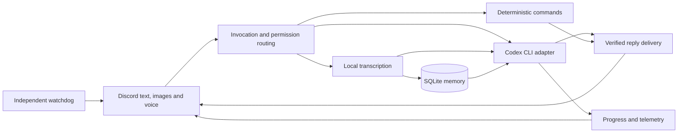

# Jarvis Discord Assistant


A Python Discord assistant that connects conversational requests to a local Codex
CLI, keeps durable conversation context, and provides voice transcription,
reminders, operational reports, and live task progress.

This repository is a sanitized snapshot of an existing personal deployment.
It contains application code, regression tests, generated status artwork, and
deployment references. Production credentials, conversations, calendars, runtime
databases, backups, and the original operational Git history are excluded.

## Capabilities

| Area | Behavior |
| --- | --- |
| Conversations | Owner requests, direct messages, per-user/channel memory, server-history context, and persistent Codex sessions. |
| Public access | Separate restricted requests, quota reserves, channel visibility checks, and constrained image generation. |
| Voice | Local voice-note transcription, live channel notes, speaker attribution, summaries, and listening controls. |
| Progress | Terminal viewer and an edited Discord dashboard, including task checklists and recovery after interrupted updates. |
| Operations | Heartbeat monitoring, queued outage/recovery notices, container status, and VPN status adapters. |
| Scheduling | Anonymous calendar timelines, recurrence/cancellation handling, personal timed reminders, and release countdowns. |
| Optional integrations | Bounded bot fallback, reward notifications, one-use reply artwork, DM reply watches, and a shared game list. |
| Maintenance | Isolated nightly development/review, regression checks, recovery checkpoints, and deployment supervision. |

## Architecture



See [architecture and data flow](docs/architecture.md),
[configuration and operations](docs/operations.md), and
[snapshot provenance](docs/publication.md).

## Run locally

The primary setup is a Linux host with Python 3.13, Git, FFmpeg, and a separately
installed, signed-in Codex CLI. Voice receive/transcription dependencies include
native libraries; a compiler may be needed when a compatible wheel is unavailable.

```sh
git clone https://github.com/5A-4D/jarvis-discord-bot.git
cd jarvis-discord-bot
python3.13 -m venv .venv
source .venv/bin/activate
python -m pip install -r requirements.txt
cp .env.example .env
mkdir -p workspace
```

Create a Discord bot, enable its Message Content intent, and grant the channel
permissions required by the features you intend to use. Edit `.env` locally:

| Setting | Purpose |
| --- | --- |
| `DISCORD_BOT_TOKEN` | Your bot credential; never commit the filled file. |
| `AUTHORIZED_USER_IDS` | Comma-separated Discord owner IDs. At least one is required. |
| `CODEX_BINARY` | `codex` on `PATH`, or an absolute executable path. |
| `CODEX_WORKDIR` | Dedicated workspace; the example uses `./workspace`. |
| `CODEX_SANDBOX` | The example selects `workspace-write`; review the actual Codex configuration used by your build. |
| `ALLOWED_CHANNEL_IDS` | Optional server-channel allowlist. |

Keep public access and voice listening disabled until their channel and access
settings are configured. Voice-note transcription is off in the starter example;
enable it when ready. The first transcription can require a model download.

```sh
codex login
python main.py
```

Examples after configuration:

```text
Jarvis, explain the last error
Jarvis remind me in 30 minutes to check the deployment
Jarvis /reminders
Jarvis /memory
Jarvis schedule tomorrow
Jarvis containers
```

Calendar and infrastructure commands need their optional adapters configured.
Owner access is authority to use the configured host workspace; application-level
prompt rules are not a substitute for operating-system isolation.

## Tests

```sh
python -m unittest discover -s tests -q
```

The suite uses temporary databases, fake event streams, and mocked external
services. It exercises permissions, reminders, image boundaries, calendar edge
cases, progress recovery, voice processing, watchdog delivery, and maintenance
gates. The calendar fixtures are synthetic test data.

Publication validation runs the complete suite in a container with no network,
a read-only source mount, and no production home, credentials, data, Docker
socket, or systemd bus. Results are recorded in [snapshot provenance](docs/publication.md).

## Deployment references

`Dockerfile`, `compose.yaml`, and `scripts/systemd/` are reference deployments.
The Compose example requires explicit host-home, workspace, and CLI paths. It
binds the selected host home for an owner-operated agent and therefore is not
a general-purpose isolation boundary. Review the mounts before use.

The native setup above is the initial development path. Host collectors,
nightly maintenance, deferred restarts, and bot-to-bot adapters require additional
configuration. No installer or service is enabled by cloning this repository.
Operational examples use `/home/your-user`, `%h`, and synthetic Discord IDs.
For an installed nightly controller, set `JARVIS_PROJECT_DIR` in its service
environment when the checkout is outside `~/Projects/jarvis-discord-bot`.

## Compatibility and scope

- The adapter depends on the Codex CLI event schema and feature flags used by
  the original deployment. A different CLI build may require adapter changes.
- Voice receive support depends on the pinned Discord receive extension and
  compatible audio libraries. Whisper transcription runs locally.
- Infrastructure reporting expects Linux and optional Docker/systemd services.
- R fallback/image routing and some personalized features retain explicit sample
  account IDs in code. Configure those adapters before enabling them.
- Calendar reports show anonymous availability only. Feed credentials and event
  details must remain private; synthetic fixtures demonstrate the behavior.
- Tests establish the checked behavior in their environment. They do not prove
  live Discord, calendar, voice, VPN, or unattended maintenance behavior on a new host.

## Assets and licensing

The status artwork under `assets/` was generated for the project. Runtime
dependencies and external services retain their respective licenses and terms.
No open-source license has been selected for this private snapshot.
