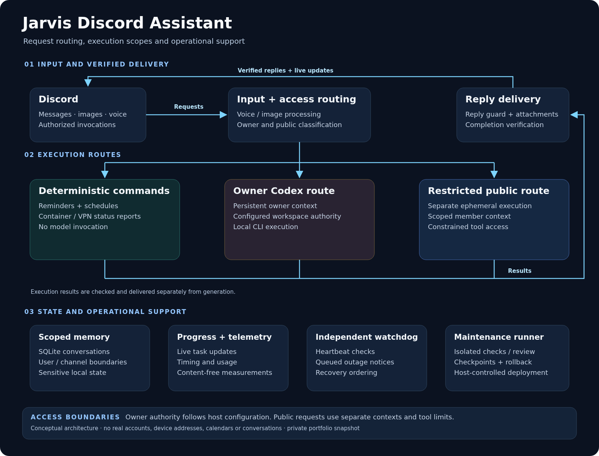
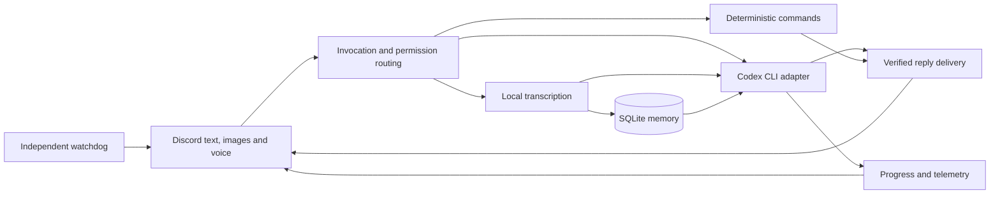

# Architecture and data flow

[Download the vector diagram](images/architecture.svg). This overview shows the
remaining request paths and supporting modules without deployment-specific data.

Editable Mermaid flow diagram

## Request lifecycle

1. `main.py` starts `JarvisDiscordClient` with settings from the local environment.
2. `bot.py` records eligible channel context and classifies invocations.
3. Deterministic commands handle reminders, usage, infrastructure reports and
   supported schedule requests without invoking a model.
4. `assistant.py` assembles scoped context and invokes the configured Codex CLI.
5. `memory.py` stores conversation/session state. Restricted requests use their
   own route rather than inheriting an owner's persistent session.
6. `progress.py` and `telemetry.py` track work and outcomes. Reply delivery remains
   separate from model completion, so a finished generation is not automatically
   treated as a delivered Discord message.

## Module map

| Module | Responsibility |
| --- | --- |
| `config.py` | Settings parsing, required owners, feature settings and persona. |
| `bot.py` | Discord events, routing, commands and message delivery. |
| `assistant.py` | CLI arguments, scoped prompts, event parsing and session handling. |
| `memory.py`, `identities.py` | SQLite memory, context retrieval and alias references. |
| `public_access.py`, `public_images.py`, `r_images.py` | Restricted request and image routing. |
| `chat_images.py` | Bounded image input retrieval and validation. |
| `voice_notes.py`, `transcription.py` | Audio segmentation, local transcription and notes. |
| `reminders.py`, `send_reminder.py`, `send_countdown.py` | Persistent reminders and scheduled messages. |
| `work_calendar.py`, `calendar_timeline.py` | Anonymous availability and text timelines. |
| `progress.py`, `telemetry.py`, `reply_guard.py` | Progress publication, content-free telemetry and delivery barriers. |
| `health.py`, `watchdog.py` | Heartbeats, outage observations and notification recovery. |
| `container_status.py`, `vpn_status.py` | Infrastructure status adapters. |
| `handoff.py` | Bounded bot fallback and loop prevention. |
| `dm_copy.py`, `dm_reply_watch.py` | Configured DM copies and explicit reply watches. |
| `reply_gif.py` | Optional one-use reply artwork. |
| `scripts/nightly_improvement.py` | Host-controlled maintenance, review, recovery and reporting. |

## Data boundaries

Conversation databases and voice transcripts stay in the configured data
directory. Raw live voice audio is discarded after processing. Progress and
telemetry are designed to avoid retaining prompts, replies and command output;
conversation memory is a separate, sensitive store.

Calendar data is parsed privately into anonymous intervals. Calendar fixtures
in tests are invented data. A configured free-series exclusion must identify only
the intended series; unrelated overlapping events continue to block time.

Public memory is scoped to the requesting member and conversation. Context is
filtered using the member's channel visibility. Bot/webhook messages do not gain
general owner authority. Restricted image outputs are bound to the requesting
turn and validated before attachment.

## Operational independence

The watchdog and collectors run independently of the main Discord worker.
Outage observations can be queued when connectivity prevents immediate delivery.
Deferred restart tooling waits for active work and reply delivery before restarting.

The optional maintenance controller operates outside the editing workspace.
Worker/reviewer environments receive a source copy and selected runtime material;
the host controller owns backups, source conflict checks, deployment and rollback.
The retained example policy restricts automatic editing to progress/telemetry
work and excludes schedule changes.
